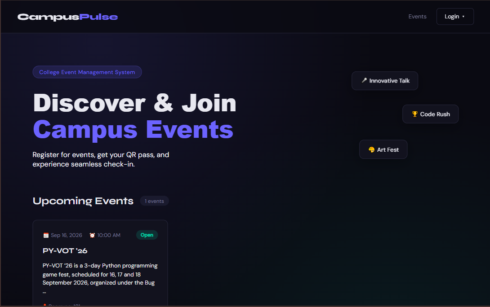
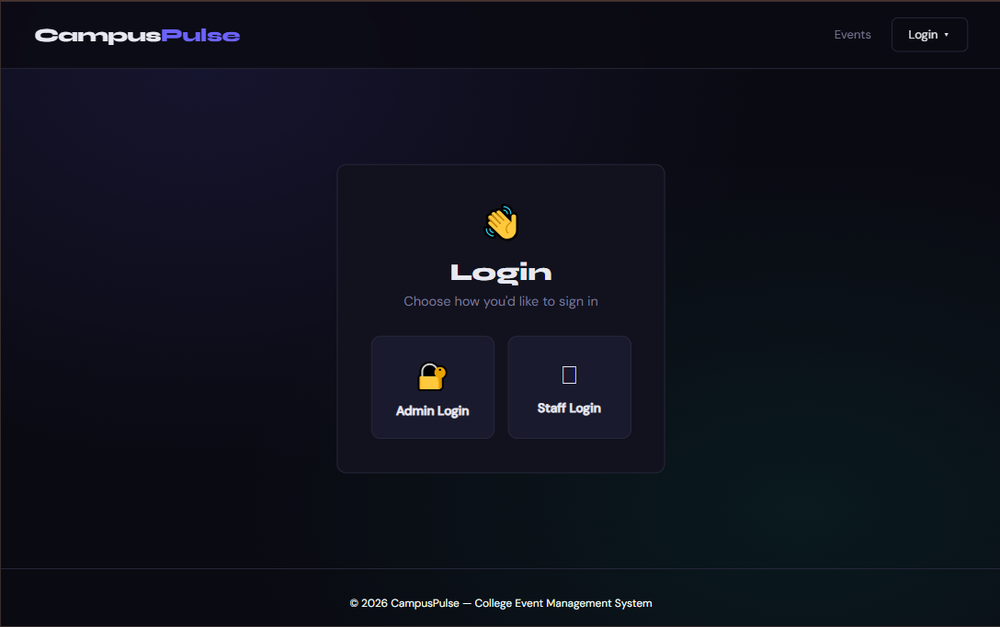
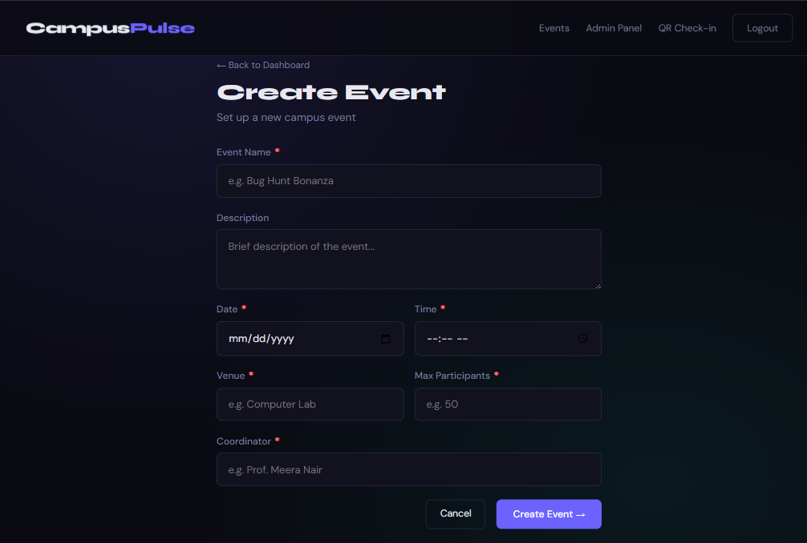
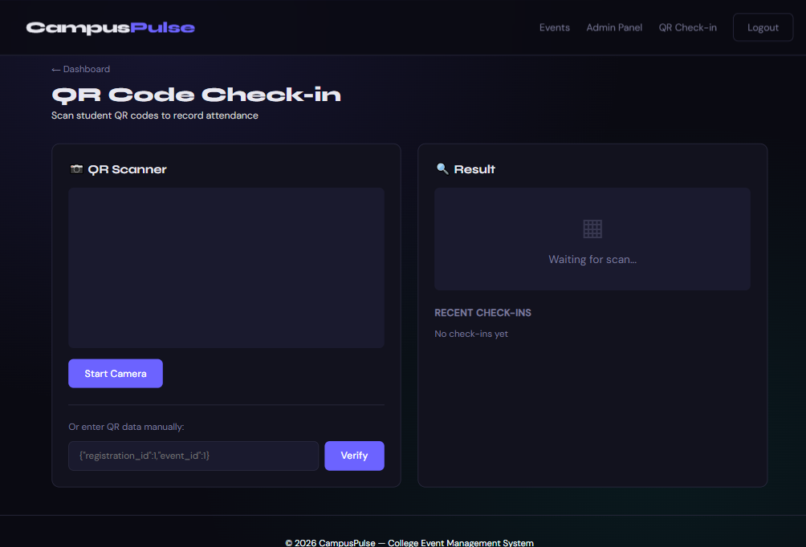

# 🎓 CampusPulse

CampusPulse is a web-based college event management system designed to simplify event creation, student registration, QR-based entry, and attendance management.

The system provides separate access for administrators and staff, allowing event organizers to manage events and registrations while staff members can handle QR-based entry and check-ins.

---

## ✨ Features

- 🎓 College event management
- 📅 Create, edit, and delete events
- 📝 Online student registration
- 🔗 Shareable event registration links
- 🎟️ Automatic QR pass generation
- 📱 QR-based event check-in
- 👥 Separate Admin and Staff access
- 🔐 Password-protected authentication
- 🛡️ Login attempt lockout
- 📊 Event registration and attendance statistics
- 🔍 Registration and attendance tracking
- 🚫 Duplicate registration prevention
- 👥 Maximum participant capacity control
- 📄 CSV export for registration and attendance data
- 📑 PDF attendance report generation
- 🔒 CSRF protection
- ✅ Server-side form validation
- 📱 Responsive interface
- 🔔 Custom notifications and confirmation dialogs

---

## 🛠️ Technologies Used

- Python
- Flask
- PostgreSQL
- Psycopg2
- Flask-WTF
- HTML5
- CSS3
- JavaScript
- Jinja2
- QR Code
- ReportLab
- Gunicorn
- Vercel

---

## 📸 Screenshots

<table>
  <tr>
    <td width="50%" align="center">
      
       
      <b>Home Page</b>
    </td>
    <td width="50%" align="center">
      
       
      <b>Login</b>
    </td>
  </tr>
  <tr>
    <td width="50%" align="center">
      
       
      <b>Admin Dashboard</b>
    </td>
    <td width="50%" align="center">
      
       
      <b>Event Management</b>
    </td>
  </tr>
  <tr>
    <td width="50%" align="center">
      
       
      <b>Student Registration</b>
    </td>
    <td width="50%" align="center">
      
       
      <b>QR Pass</b>
    </td>
  </tr>
  <tr>
    <td width="50%" align="center">
      
       
      <b>QR Check-in</b>
    </td>
    <td width="50%" align="center">
      
       
      <b>Attendance</b>
    </td>
  </tr>
</table>
---

## 🔐 Security & Validation

CampusPulse includes several security and validation mechanisms to make the system more reliable:

- CSRF protection for state-changing requests
- Password hashing
- Secure session handling
- Server-side form validation
- Email and phone format validation
- Duplicate registration checks
- Event capacity enforcement
- Login attempt tracking
- Temporary account lockout after repeated failed logins
- Separate authentication and permissions for Admin and Staff roles
- Parameterized database queries

---

## 💡 Highlights

- QR passes are generated automatically after successful registration.
- Students cannot register multiple times for the same event.
- Event capacity is checked before accepting registrations.
- Attendance is recorded through QR verification.
- Duplicate check-ins are prevented.
- Registration and attendance data can be exported as CSV.
- Attendance reports can be generated as PDF.
- Admin and Staff access are separated according to their responsibilities.
- The interface is designed to work across desktop and smaller screens.

---

## 🎯 Purpose

The main goal of CampusPulse is to provide a centralized system for managing college events while reducing the manual work involved in registrations and attendance.

It combines event management, student registration, QR-based entry, attendance tracking, and report generation into a single web application.

---

## 🚀 Future Improvements

- 📧 Email confirmation after registration
- 📱 Dedicated mobile interface for event staff
- 📊 More detailed attendance analytics
- 🔔 Event reminders and notifications
- 🗓️ Calendar integration
- 👤 Student registration history
- 📸 Improved QR scanning experience
- 📈 Advanced event analytics

---

## 👨‍💻 Author

**Priyam Prabhat**

Computer Science Student | Web Development | Cybersecurity

---

## ⭐ Support

If you find CampusPulse useful or interesting, feel free to give the repository a star!
